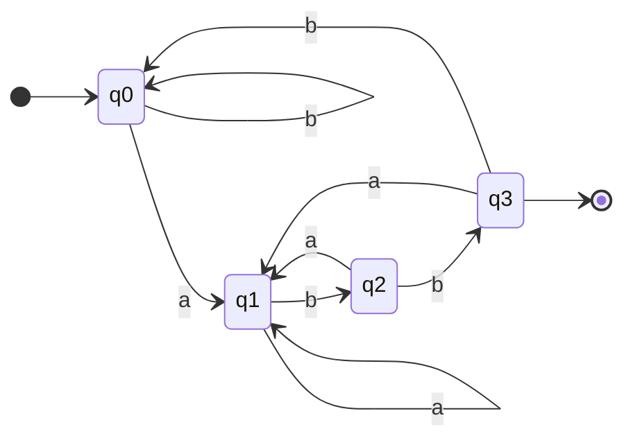
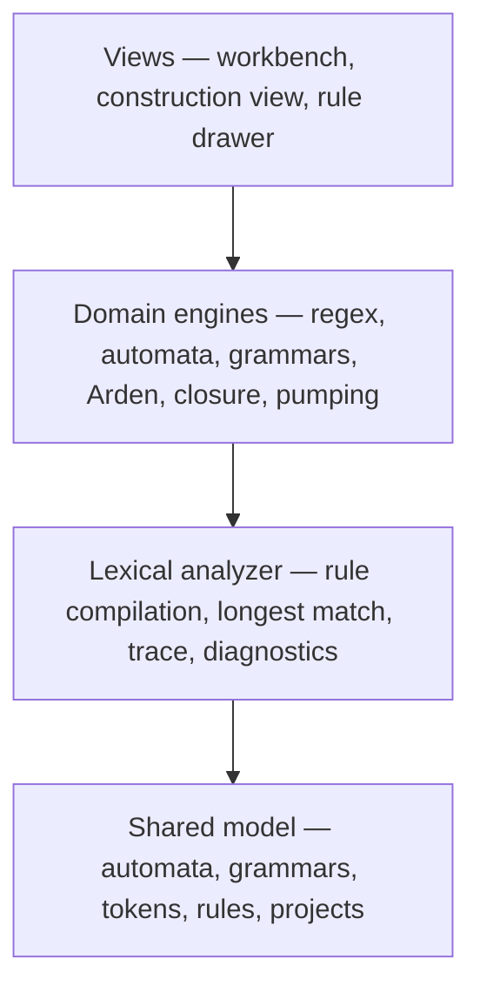
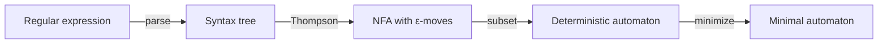
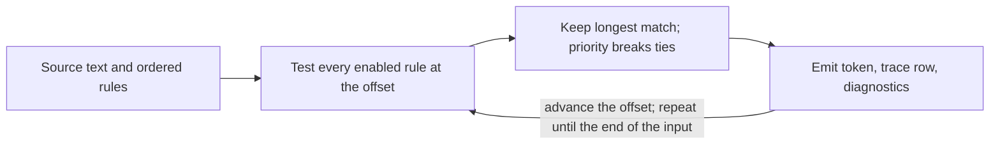

# Munch — Diagram Sources and Screenshot Capture List

Companion document to `Munch-Paper-final.md` (the paper). It holds the text sources for
Figures 1–5, the commands that regenerate them, and the capture list for the screenshots that
still have to be taken from the running application.

Everything here is reproduction material for the paper. It does not describe features that the
application does not have.

---

## 1. Files

| File | Role |
| --- | --- |
| `docs/figures/make-figures.mjs` | Generator. Writes the five `.svg` sources and a matching `.html` wrapper for each figure. |
| `docs/figures/fig1-dfa.svg` … `fig5-scan-loop.svg` | Vector sources from which the embedded PNGs are rasterised. |
| `docs/figures/fig1-dfa.html` … `fig5-scan-loop.html` | One-page wrappers used only for rasterising. |
| `docs/figures/fig1-dfa.png` … `fig5-scan-loop.png` | Raster images embedded in the `.docx` and `.pdf`. |

Current raster sizes (must match the SVG `width`/`height`):

| Figure | PNG size | Content |
| --- | --- | --- |
| `fig1-dfa.png` | 1000 × 400 | Minimal DFA for `(a\|b)*abb` |
| `fig2-pumping.png` | 1000 × 260 | Pumping decomposition `s = xyz` |
| `fig3-architecture.png` | 1000 × 320 | Four layers of the implementation |
| `fig4-pipeline.png` | 1000 × 250 | Expression → minimal automaton |
| `fig5-scan-loop.png` | 1000 × 320 | Longest-match scanning loop |

## 2. Regenerating the figures

```bash
# 1. write the SVG and HTML sources
node docs/figures/make-figures.mjs docs/figures

# 2. rasterise each figure at its exact SVG size (Chrome, device scale 1)
chrome --headless=new --hide-scrollbars --force-device-scale-factor=1 \
       --window-size=1000,400 --screenshot=docs/figures/fig1-dfa.png \
       file:///<abs-path>/docs/figures/fig1-dfa.html
```

Use the height from the table above for each figure. The window height must equal the SVG height,
otherwise the PNG gains a white band. On Windows the executable is normally
`C:\Program Files\Google\Chrome\Application\chrome.exe`.

If a figure changes, regenerate its PNG first and then re-export the document so that the new image
is embedded. The `.docx` and `.pdf` in this repository were produced from
`Munch-Paper-final.md` with a small converter that is kept outside the repository, so the authors
should use their own tool (Word, pandoc, or a similar exporter) when they edit the paper.

Fonts and colours are set by two constants at the top of `make-figures.mjs` (`FONT`, and the
palette below it). The figures deliberately use a sans-serif face because their labels print at
roughly 8 pt; switching `FONT` to `"Times New Roman"` will match the body text but reduce
legibility at that size.

## 3. Text sources for each diagram

The sources below are the text form of each figure. They are here so a figure can be rebuilt or
edited without redrawing it by hand. Figures 1–5 in the paper are already produced from the SVG
files; these are for maintenance.

### Figure 1 — Minimal DFA for strings over `{a,b}` ending in `abb`

State table used by the drawing (identical to Table 2 of the paper):

| State | on `a` | on `b` | Accepting |
| --- | --- | --- | --- |
| q0 (start) | q1 | q0 | no |
| q1 | q1 | q2 | no |
| q2 | q1 | q3 | no |
| q3 | q1 | q0 | yes |



### Figure 2 — Pumping decomposition

Not a state diagram, so it is drawn as two bars rather than in Mermaid.

```text
 s = x y z ,  |s| >= p ,  xy^i z in L for every i >= 0

 |------ x ------|--- y ---|--- z ------------|
 |<--------- |xy| <= p -------->|
                  ^
                  |y| >= 1  (the loop)
```

### Figure 3 — Four layers

Matches Section 3.1 and Table 6 of the paper. Keep the layer names identical in both places.



The view layer is one workbench plus two overlays: the construction view replaces the graph
inside the DFA panel, and the rule drawer slides over the left edge. There is no workbench
selector in the header, and the figure should not imply one.

### Figure 4 — Compilation pipeline



### Figure 5 — Scanning loop



## 4. Exporting a Mermaid source

Any of the following produces a vector image:

- `mermaid.live` — paste the block, use *Actions → PNG* (set width ≥ 1600 px) or *SVG*.
- VS Code with the *Markdown Preview Mermaid Support* extension — preview, then export.
- `npm install -g @mermaid-js/mermaid-cli`, then
  `mmdc -i figure.mmd -o figure.svg -b white`.

After export, set the image to the full text width of the page (about 6.27 in) without
stretching, and keep the caption below the image.

## 5. Screenshots still required

The paper currently contains diagrams only. Screenshots of the running application are the
remaining evidence of Section 4 and should be inserted as Figures 6–11, after Figure 5. Take them
from the built application at a desktop width (1280 px or wider) so the labels stay readable.

| No. | Surface | What the capture must show | Suggested crop |
| --- | --- | --- | --- |
| 6 | Workbench | Source `2items = 42;`, the seven tokens with positions, the trace row that produced `2`, and the Recognizer panel with the active state | Editor + token list + right-hand panel |
| 7 | Construct, stages 1–4 | The identifier `calculateTotal` selected, the ε-NFA / DFA / minimal DFA tabs, and the footer counts `6 states · 123 transitions`, `3 · 182`, `2 · 118` | Right-hand panel only, header included |
| 8 | Construct, stage 5 | The grammar view: five display lines, the derivation of `calculateTotal`, and the footer `119 productions · 5 display lines` | Right-hand panel only |
| 9 | Construct, Arden | The printed expression, the elimination steps, and the caveat that the expression is not claimed to be minimal | Right-hand panel, expression and steps |
| 10 | Rules drawer, Rules tab | The finding after the priority swap: `KEYWORD — Every string this rule matches is also matched by IDENTIFIER…`, the `never matches: IDENTIFIER` badge, and the token stream behind the drawer showing `function` as `IDENTIFIER` | Whole window; the stream must stay visible beside the drawer |
| 11 | Rules drawer, Limits tab | The four non-regular languages with their formulas, and the paragraph on nested block comments | Drawer only |

Reproduction notes, all verified in the running build:

- **Workbench (6).** Choose the `JavaScript / TypeScript` preset in the header. Type
  `2items = 42;` into the editor and press **▷ Run**. The token stream shows `2` as
  `INTEGER_LITERAL`, `items` as `IDENTIFIER`, and no rule error. Clicking a token moves the
  trace to the step that produced it and points the DFA panel at that token's rule.
- **Construct (7, 8).** With `IDENTIFIER` selected, press **Construct** in the DFA panel header.
  The stage buttons read `1. Syntax tree`, `2. ε-NFA`, `3. DFA`, `4. Minimal DFA`, `5. Grammar`.
  The counts quoted in the paper are the footer of stages 2, 3, and 4. The grammar stage is
  reachable only after **Construct** is active, and the derivation names the selected lexeme.
- **Arden (9).** The button **Arden: print equivalent expression** is present in every stage and
  always solves the minimized machine. The expression is long for the identifier rule because its
  alphabet is large; capture the expression line and the first few elimination steps.
- **Rules drawer (10).** Press **⚙ Rules**. The header reports `19/19 enabled` and the finding
  line reports the number of pairs compared. Change `KEYWORD`'s priority from 3 to 7 and
  `IDENTIFIER`'s from 7 to 3; after the 250 ms debounce the finding and the badge appear. Close
  the drawer without restoring the values to show the changed token stream, or capture with the
  drawer still open if the stream remains visible. Restore the priorities afterwards.
- **Limits (11).** In the same drawer, press **Limits**. The four languages are `Equal As and Bs`,
  `Palindromes (Even Length)`, `Square Lengths`, and `Prime Lengths`. Each entry expands to its
  witness and pumping argument; the nested-comment paragraph sits above the list.

Do not crop out a panel header: it identifies the surface and makes the caption unnecessary.
Do not retouch, recolour, or stitch captures.

## 6. Renumbering if screenshots are added

The paper numbers figures consecutively. Inserting the six screenshots as Figures 6–11 leaves
Figures 1–5 unchanged, so no renumbering is needed. If a screenshot is dropped, close the gap and
update every in-text reference to that figure as well as its caption.

Every figure must be referred to in the body text before or near where it appears.

## 7. Checklist

- [ ] `node docs/figures/make-figures.mjs docs/figures` runs without error.
- [ ] Each PNG matches the size in Section 1; no white band at the bottom or right.
- [ ] Figure 3 lists exactly the four layers named in Section 3.1 and Table 6.
- [ ] Figure 3 shows one workbench with two overlays, not a workbench selector.
- [ ] Figure 4 caption describes only the arrows that are drawn.
- [ ] Screenshots 6–11 captured from the built application, not from a mock-up.
- [ ] Screenshot 10 shows both the finding and the changed token stream.
- [ ] Captions use the form `Figure N.` in bold, followed by a sentence in the same paragraph.
- [ ] Every figure is referenced in the text.
- [ ] The `.docx` and `.pdf` were rebuilt after the last image change, and both show the same
      figure order.
