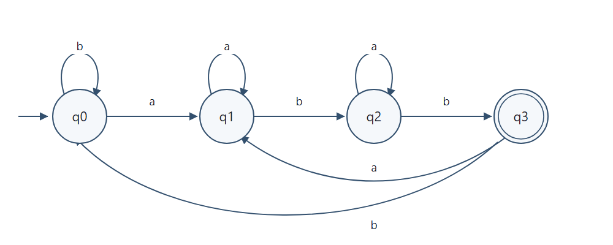
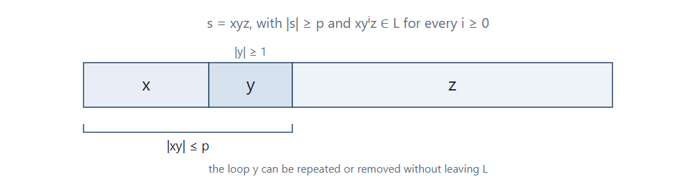
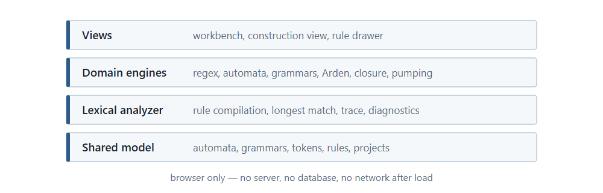
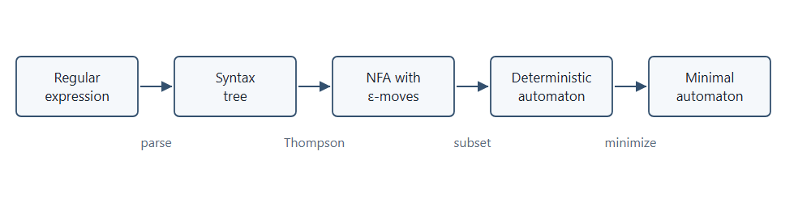
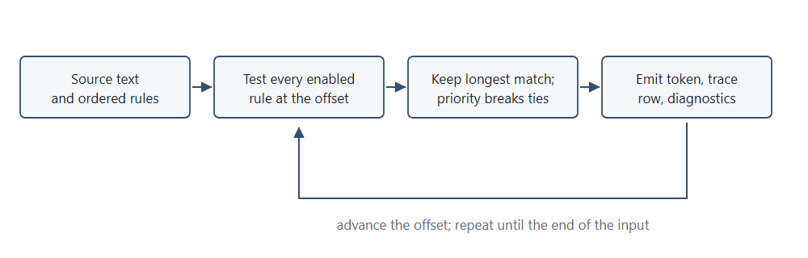

## Abstract

Munch is a browser-based lexical analyzer that is also a working demonstration of regular-language theory. It has one workspace. Source text is scanned by ordered regular-expression rules, and every token decision is recorded: the offset, the candidates, the longest match, and the rule that won. The theory is not presented in separate panels beside the analyzer; it is used by the analyzer at four moments. At scan time the rules are regular expressions. At build time each rule is opened as a construction: syntax tree, Thompson ε-NFA, subset DFA, minimal DFA, and the right-linear grammar of the same language, from which the selected lexeme is derived. Arden's theorem runs on the same machine and prints an equivalent expression. At analysis time the rule set is checked with the closure properties of regular languages—subset, equality, intersection, and emptiness over product machines—so rules that can never fire, duplicate rules, and same-priority overlaps are reported before they surprise anyone. At the boundary, the pumping lemma explains token classes that no finite automaton can define, such as nested comments. This paper documents the system as implemented, explains the theory each surface uses, and reports the verification results: ten test suites containing 229 tests, a clean TypeScript compile, and a successful production build. It also states the limits: the scanner executes native regular expressions, the automata are models of the rules, and no study of learning outcomes was conducted.

**Keywords:** regular languages, regular expressions, finite automata, regular grammars, Arden's theorem, closure properties, pumping lemma, lexical analysis

## 1. Introduction

### 1.1 Background of the Project

Every compiler and interpreter begins with lexical analysis. Source text is grouped into tokens before a parser can work with it, and most token classes are described by a regular expression and recognized by a finite automaton. This is the standard practical application of regular-language theory in compiler construction (Aho et al., 2006).

The same objects appear in an automata-theory course, but usually as separate exercises: a deterministic automaton here, a grammar conversion there, and a pumping-lemma proof at the end of the term. A student can complete every exercise and still not see how the pieces fit together, because the exercises never share a language, a notation, or a tool. The connection between the two courses is left implicit.

Munch was built to make that connection explicit inside one tool. It contains a single workbench, the lexical analyzer, and the theory is used by that analyzer rather than displayed beside it. The distinction matters, and it is the organizing idea of this paper. At **scan time** the rules are regular expressions and the trace is a longest-match decision. At **build time** the rule behind any token is compiled to a syntax tree, an ε-NFA, a deterministic automaton, a minimal automaton, and a right-linear grammar; Arden's theorem converts the machine back into an expression. At **analysis time** the rule set is checked with the closure properties of regular languages, so a rule that can never fire is reported as a fact about its language rather than discovered by testing inputs. At the **boundary**, the pumping lemma explains why certain token classes cannot be written as rules at all.

Table 8 in Section 4.1 summarizes these four moments, the surface that exposes each one, and the theoretical object involved. The application is a documentation and experimentation tool, not a general-purpose lexer generator. It was developed as a student project and is evaluated here on that basis.

### 1.2 Problem Statement

Four difficulties motivated the project.

First, formal-language theory is usually taught without executable feedback. Definitions of determinism, ε-closure, or state elimination are stated in text, and the student must imagine the machine. Constructions such as Thompson's or the subset construction are described as proofs, so errors in understanding are discovered only when an examination is marked.

Second, the rules that drive a real lexer are opaque in practice. When a tokenizer produces an unexpected token, the cause may be rule order, rule priority, an expression that matches more text than intended, or maximal munch. A token dump does not show which of these happened.

Third, rule sets decay silently. Adding a token class can make an existing rule unreachable, because a later rule with a broader pattern captures everything the old one matched. The scanner does not complain; it simply never emits the old token. Finding the cause by trying inputs is slow and incomplete, and the property at issue—one language contained in another—is exactly what regular-language closure operations can decide.

Fourth, the standard representations of a regular language—expression, automaton, grammar, and state equations—are taught as separate topics. Moving between them is examined in principle but rarely performed by the student on one concrete language, and almost never on the language of a working token rule.

Munch addresses these four difficulties in one application: every construction is executed and displayed step by step, every token decision is recorded with the candidates that competed for it, the rule set is analysed with set operations, and the representations are interconvertible from a shared model.

### 1.3 Objectives

The project had six objectives.

1. Implement a working lexer that takes ordered regular-expression rules and reports tokens, source positions, diagnostics, and a step-by-step record of each longest-match decision.
2. Compile the rule behind any selected token through the full pipeline—syntax tree, ε-NFA, subset DFA, minimal DFA—and derive the right-linear grammar of the same language, including a derivation of that token's lexeme.
3. Implement Arden's theorem as an executable state-elimination procedure that derives a regular expression from the machine of a selected rule.
4. Implement a rule-set analysis based on the closure properties, reporting rules whose language is empty, rules shadowed by an earlier rule, duplicate rules, and same-priority overlaps.
5. Implement a limits view that uses the pumping lemma to explain non-regular token classes, and to justify refusing them rather than approximating them.
6. Validate the implemented behaviour by automated tests rather than by inspection. Section 5 reports the result.

### 1.4 Scope and Limitations

The scope of the system is regular languages, their standard representations, and one practical application of them, lexical analysis. The workbench accepts regular-expression rules from a preset or edited by hand, plus arbitrary source text.

The following limitations are part of the design and are reported here rather than discovered later by a reader.

- **Regular languages only.** Munch contains no parser, pushdown automaton, or context-free grammar. Balanced and counting languages are outside its scope. Section 6.2 explains why this boundary is fundamental rather than a missing feature.
- **Automata are models, not the scanner.** The tokenizer executes native JavaScript regular expressions with the sticky flag. The automaton built for the same rule is used for display, simulation, grammar conversion, and Arden's theorem. The two paths agree on the token stream for the supported syntax but are not the same code path. A DFA-driven scanner is described as future work in Section 7.2, with the two gaps that must be closed first.
- **Lazy quantifiers are compiled as greedy ones.** The default `BLOCK_COMMENT` rule uses `[\s\S]*?` so that the scanner stops at the first `*/`. The parser treats the trailing `?` as an optional operator, so the model's language is the set of strings from `/*` to a final `*/`. On the lexeme actually emitted the two agree, because that lexeme is a prefix of the model's language and is accepted; the model is nevertheless larger than the scanner's match policy.
- **Word boundaries are treated as empty moves.** The native matcher enforces `\b`, but the generated automaton treats it as an ε-transition. This affects what the visualization claims about boundary assertions, not the token stream.
- **Finite character universe.** Because an automaton cannot enumerate an infinite alphabet, the symbol `"."`, negated classes, and the wildcard are expanded over printable ASCII, common whitespace, and any character named in the pattern. The automaton is exact for that universe; the native matcher may accept characters outside it.
- **Anchors and advanced syntax.** A leading `^` and trailing `$` are stripped, since acceptance in a whole-string automaton is already decided at the end of the input. Lookahead, lookbehind, and backreferences are rejected with an error. Case-insensitive compilation mirrors ASCII letters only.
- **The analysis is bounded.** At most 40 enabled rules are compared, a pair whose product exceeds 3000 expanded states is abandoned, and the whole comparison stops after 1.5 seconds. When a limit is reached the drawer labels the result as partial instead of presenting it as complete.
- **The limits view is a guided explorer.** It contains four standard non-regular languages and their proofs; it is not a general non-regularity prover.
- **Limited validation evidence.** The automated tests check specified behaviour for the inputs they contain. They do not prove the absence of defects, and no performance benchmark, cross-browser test, or user study was conducted. Appendix C lists the verification that remains for the authors to complete.

## 2. Theoretical Foundations

This section defines the concepts that the workbench uses. Each subsection closes by naming the surface that exercises the concept, so that theory and implementation can be read together. Definitions follow the standard textbook treatment (Hopcroft et al., 2006; Sipser, 2012).

### 2.1 Regular Languages and Regular Expressions

An **alphabet** Σ is a finite, non-empty set of symbols. A **string** is a finite sequence of symbols, and ε denotes the string of length zero. The set of all finite strings over Σ is written Σ\*. A **language** is any subset of Σ\*. The usual operations on languages are union, intersection, difference, complement with respect to Σ\*, concatenation, and Kleene star.

A language is **regular** if it can be recognized by a finite automaton, generated by a regular grammar, or denoted by a regular expression. These three characterizations are equivalent, a result established by Kleene (1956) and by McNaughton and Yamada (1960). Munch relies on the equivalence as an operational fact: a token rule is a regular expression, it is compiled into an automaton, that automaton is read as a regular grammar, and Arden's theorem turns it back into an expression. The same language is therefore present in four notations at once, which is what makes the construction view possible.

The expression syntax accepted by the parser in `regexToAutomaton.ts` is listed in Table 1.

Table 1. Regular-expression syntax supported by the parser.

| Form | Meaning | Example |
| --- | --- | --- |
| `a` | the literal symbol `a` | `abc` |
| an empty pattern | the empty string ε | `()` |
| `r1 r2` | concatenation | `ab` |
| `r1 \| r2` | union (alternation) | `a\|b` |
| `r*` | zero or more repetitions | `(ab)*` |
| `r+` | one or more repetitions | `a+` |
| `r?` | zero or one occurrence | `a?` |
| `r{n}`, `r{n,}`, `r{n,m}` | bounded repetition, limits up to 100 | `a{2,4}` |
| `(r)` | grouping | `(a\|b)*` |
| `[abc]`, `[a-z]`, `[^abc]` | character class, optionally negated | `[A-Za-z_]` |
| `\d`, `\w`, `\s` | digit, word character, whitespace | `\d+` |
| `\D`, `\W`, `\S` | complements of the classes above | `\S+` |
| `\n`, `\t`, `\r`, `\f`, `\v`, `\0` | control and escape characters | `\n` |
| `.` | any character in the finite universe | `.*` |

Postfix operators bind most tightly, then concatenation, then union, so `ab|c*` means `(ab)|(c*)`. The parser reports five classes of syntax error: an unexpected character, an unclosed group, an unclosed character class, a misplaced quantifier, and an unsupported lookahead assertion. The error is displayed in place of a graph rather than producing a partial construction.

A finite automaton has a fixed amount of memory, so it cannot count an unbounded number of symbols or match arbitrarily nested structure. The standard examples of languages that are therefore not regular are listed below. All four appear in the Limits tab.

- `{ aⁿbⁿ | n ≥ 0 }`, the strings with equally many `a` and `b` symbols;
- `{ w wᴿ | w ∈ {0,1}* }`, the even-length palindromes;
- `{ 0^(n²) | n ≥ 0 }`, the strings whose length is a perfect square;
- `{ aᵖ | p is prime }`, the strings whose length is prime.

The practical consequence is that a lexer can recognize an opening brace and a closing brace but cannot check that they balance. That check belongs to a parser with a stack. The same consequence applies inside a single token: a block comment that may contain nested block comments cannot be recognized by a rule, because recognizing it requires counting the depth. The default `BLOCK_COMMENT` rule stops at the first `*/` for exactly this reason, and Section 4.4 uses the point as the closing step of the demonstration.

### 2.2 Finite Automata

A **deterministic finite automaton** is a five-tuple M = (Q, Σ, δ, q₀, F), where Q is a finite set of states, δ : Q × Σ → Q is the transition function, q₀ is the start state, and F ⊆ Q is the set of accepting states. The transition function is extended to strings in the usual way, and the language of M is defined by Equation 1.

$$
\tag{1} L(M) = { w ∈ Σ* | δ*(q₀, w) ∈ F }
$$

A **nondeterministic finite automaton** replaces δ with a relation: several moves may be available for one symbol, and a string is accepted if at least one path reaches an accepting state. An **ε-NFA** additionally allows moves that consume no input. Before a move on a symbol, the machine may follow any number of ε-moves; the set of states reachable this way is the ε-closure of a state set.

Three constructions connect these machines to regular expressions.

**Thompson's construction** builds an ε-NFA directly from an expression (Thompson, 1968). Each operator has a small fragment: a literal is two states joined by a labelled edge, concatenation joins the accepting state of one fragment to the start of the next with an ε-edge, union adds a new start and a new accepting state with ε-edges to and from both branches, and star adds a skip edge and a loop edge. An expression of length m produces an automaton with O(m) states.

**The subset construction** converts a nondeterministic machine into a deterministic one. Each state of the result is a *set* of states of the original machine, the start state is the ε-closure of the original start state, and the successor of a set on a symbol is the ε-closure of everything reachable on that symbol. Only sets that are actually reachable are built. The number of states can grow exponentially in the worst case, although token rules in practice produce small machines.

**Minimization** removes unreachable states and then merges states that cannot be distinguished by any continuation. Munch partitions the states into accepting and non-accepting groups and repeatedly splits a group when its members disagree on the destination group for some symbol. Once the partition is stable, each group becomes one state. The result accepts the same language with the fewest possible states. The implementation uses this straightforward refinement rather than the asymptotically faster algorithm of Hopcroft (1971), which is noted here for accuracy.

Table 2 and Figure 1 show the standard illustrative example: the set of strings over `{a,b}` that end in `abb`. It is used in this section because it is small enough to check by hand; the construction view applies the same pipeline to the rule of whichever token is selected.

Table 2. Transition table of the minimal DFA for `(a|b)*abb`.

| State | on `a` | on `b` | Accepting |
| --- | --- | --- | --- |
| q0 (start) | q1 | q0 | no |
| q1 | q1 | q2 | no |
| q2 | q1 | q3 | no |
| q3 | q1 | q0 | yes |



The word `abb` is accepted by the path q0 → q1 → q2 → q3. The word `ab` is rejected because the machine stops in q2, and `babb` is accepted by the path q0 → q0 → q1 → q2 → q3.

The same pipeline runs on real token rules. For the JavaScript identifier rule `[A-Za-z_$][A-Za-z0-9_$]*`, the ε-NFA produced by Thompson's construction has 6 states and 123 transitions, the subset construction produces a 3-state DFA with 182 transitions, and minimization reduces it to 2 states and 118 transitions. Those counts are read from the construction view in the running build. The keyword rule, which is a union of 50 reserved words with a trailing `\b`, produces a 137-state minimal machine; the difference between the two numbers is the reason the analysis budgets its comparisons.

A note on cost is useful because it explains a boundary of the approach. Thompson's construction is linear in the pattern and the subset construction is exponential in the worst case, while minimization is polynomial. A scanner can avoid automata altogether by using a backtracking regular-expression engine, but then the running time depends on the pattern, and pathological patterns can take a very long time (Cox, 2007). Munch takes the second route for matching and the first route for explanation, for the reasons given in Section 3.3.

### 2.3 Regular Grammars

A **regular grammar** in right-linear form has productions of the three shapes shown in Equation 2, where A and B are non-terminals and a is a terminal symbol.

$$
\tag{2} A → aB,  A → a,  A → ε
$$

At most one non-terminal may appear on a right-hand side, and it must be the rightmost symbol. Left-linear grammars, in which the non-terminal is leftmost, describe the same class of languages; Munch accepts the right-linear form because it maps directly onto an automaton whose states are the non-terminals.

The conversion is a direct reading of the productions. A production `A → aB` becomes a transition from A to B on `a`; a production `A → a` becomes a transition from A to a fresh accepting state on `a`; a production `A → ε` makes A accepting; and the start symbol becomes the start state. The reverse conversion writes `A → aB` for every transition and `A → ε` for every accepting state.

In Munch the grammar view reads the minimized machine of the selected rule in this way. A production is printed for every transition, and an ε-production is printed for every accepting state, so the grammar generates exactly the language of the rule. For a machine with a large alphabet the list is long—one production per symbol—so consecutive symbols that share a source and a target are folded into a bracketed class for display, for example `q1 → [A-Z_a-z]q2`. The fold is presentation only: it stands for one production per symbol, it is labelled as such in the view, and a unit test pins both the fold and the cases where a symbol must stay literal. The minimizer has already merged equivalent states, so the grammar of the identifier rule needs only two non-terminals and 119 productions, displayed as five lines.

The derivation of a token's lexeme is the part that connects the grammar to the run. The view walks the minimized machine along the selected lexeme, turning each step into a sentential form. For the identifier `calculateTotal` the derivation begins

$$
\tag{3} s1 ⇒ c s0 ⇒ ca s0 ⇒ cal s0 ⇒ … ⇒ calculateTotal s0 ⇒ calculateTotal,
$$

and the final step applies the ε-production of the accepting state; `s1` is the start state and `s0` the accepting state of this machine. Equation 3 is quoted from the running build, shortened in the middle. This correspondence is also the clearest illustration of the memory limit: a production can carry exactly one non-terminal forward, which corresponds to exactly one state of memory. A grammar that would need to count nesting depth would need a non-terminal for each depth, and there would be no finite bound.

### 2.4 Arden's Theorem

Arden's theorem gives the solution of a linear equation over languages (Arden, 1961). If P and Q are regular expressions and ε is not in the language of P, then Equation 4 holds.

$$
\tag{4} R = Q + R·P  ⇒  R = Q·P*
$$

The mirror form, `R = P·R + Q ⇒ R = P*·Q`, is equally useful; the two differ only in the order of concatenation.

The side condition matters. If ε belongs to P, the equation may have several solutions, and `Q·P*` is the least of them rather than the only one. For the systems produced by an automaton the condition holds, which is what makes state elimination well defined.

The proof is short. Substituting `Q·P*` into the right-hand side gives `Q + (Q·P*)·P = Q·(ε + P*·P) = Q·P*`, so the expression is a solution. For uniqueness, any solution can be unfolded repeatedly into `Q + Q·P + Q·P² + …`, which is contained in `Q·P*`; conversely every finite term of that series is obtained by unfolding. This is the language-level form of solving a linear recurrence, with the star acting as the loop.

The theorem becomes an algorithm when it is applied one state at a time. For an automaton with states q₀ … qₙ, write one equation per state, as in Equation 5: the right-hand side is the sum of `a·Xⱼ` over every transition from the state and, for accepting states, the empty string.

$$
\tag{5} Xᵢ = Σ a·Xⱼ  (for each transition qᵢ → qⱼ on a)  +  (ε if qᵢ ∈ F)
$$

Eliminating a state q reroutes every path that passed through it. If the current expression from state i to state j is R(i,j), the rerouted expression is given by Equation 6, which is Arden's theorem applied to the loop at q.

$$
\tag{6} R'(i,j) = R(i,j) + R(i,q)·R(q,q)*·R(q,j)
$$

After every state except the start has been eliminated, the language of the machine is the sum over accepting states f of `(R(start,start))*·R(start,f)`. The star accounts for loops at the start state, and the order of elimination changes the size of the result but not the language it denotes. Table 3 follows the procedure on a two-state machine with `q0 →a q0` and `q0 →b q1`, where q1 is accepting.

Table 3. State elimination for a machine accepting `a*b`.

| Step | Expression |
| --- | --- |
| Initial entries | `R(q0,q0) = a`, `R(q0,q1) = b`, `R(q1,q1) = ε` |
| Eliminate q1 | `R'(q0,q0) = a + b·ε*·∅ = a` |
| Result | `(a)*·b = a*b` |

The solver in Munch performs this elimination symbolically. Expressions are stored as a small syntax tree rather than as text, because an earlier string-based version could rewrite `s10` while eliminating `s1`. The tree also allows parentheses to be added only where they are needed, and lets `∅` and `ε` be simplified during construction. The construction view runs the solver on the minimized machine of any selected rule, so the reverse direction is available for real token classes and not only for textbook examples. The output is a correct expression for the language, not necessarily the shortest one; Arden's method is a construction, not a minimizer.

### 2.5 Closure Properties

Regular languages are closed under a wide range of operations. Munch implements six of them constructively, meaning that each operation returns an automaton for the result rather than only a proof of existence. Table 4 lists the operations and the construction used for each.

Table 4. Closure operations implemented by the engine.

| Operation | Definition | Construction used in Munch |
| --- | --- | --- |
| Union | L1 ∪ L2 | Complete both machines over a shared alphabet, build the product, accept if either component accepts. |
| Intersection | L1 ∩ L2 | Same product, accept if both components accept. |
| Difference | L1 \ L2 | Same product, accept if the first accepts and the second does not. |
| Complement | Σ\* \ L | Complete the machine with a sink state, then exchange accepting and non-accepting states. |
| Concatenation | L1 · L2 | Add ε-moves from every accepting state of M1 to the start of M2, keep the accepting states of M2, then determinize. |
| Kleene star | L\* | Add a new start and a new accepting state, allow the body to be skipped, add ε-moves from each old accepting state back to the old start, then determinize. |

The Boolean operations share one construction. Let M1 and M2 be deterministic machines over a common alphabet. Each is first completed by adding a sink state that loops on every symbol, so that a missing transition is represented explicitly rather than treated as an immediate rejection. The product machine then has pairs of states as its states, the pair of start states as its start state, and the pair of successors on each symbol as its transition. The accepting condition is the Boolean operation named in Table 4. Only reachable pairs are generated, so the product is often much smaller than the full Cartesian product.

Completion is not a technicality. If one machine is partial, its missing transitions behave like rejection, and the product would stop tracking the other machine. For complement this produces the wrong language, which is the most common error in hand-built implementations.

Concatenation and star are ε-moves rather than products. For concatenation, the accepting states of the first machine are connected to the start of the second without consuming input, and the accepting states of the second machine become the accepting states of the result. For star, a new start state can either skip the body or enter it, and every old accepting state can return to the old start; the new start can also reach a new accepting state directly, so the empty string is always included. These two operations are exercised by the test suite; the analyzer itself needs only the Boolean ones, as described next.

**Where the analyzer uses closure.** The rule-set analysis in `ruleAnalysis.ts` answers four questions about the languages of token rules, and every answer is a closure question in disguise. Let A be a rule that is tried earlier and B a rule that is tried later, in the scanner's order of priority and then list position.

- **Emptiness.** Does the language of a rule contain any string at all? The machine is traversed from its start state; if no accepting state is reachable, the rule can never produce a token. This catches a pattern such as `[]`.
- **Subset.** Is L(B) contained in L(A)? Equivalently, is the difference L(B) \ L(A) empty? The implementation performs this as a breadth-first search over the product of B with the completed machine of A, and reports a counterexample state as soon as B accepts while A does not. A containment proves that B can never win a token, because A is tried first and matches at least as much.
- **Equality.** Is L(B) equal to L(A)? Two subset tests, in both directions. Equality is the special case of shadowing in which the two rules describe the same language, so the later rule is a duplicate.
- **Intersection.** If the priorities are equal and neither rule contains the other, do the languages overlap at all? The product search above, restricted to pairs of accepting states, answers this. An overlap means that the listing order decides the token, which is a fragile arrangement even when it is currently intended.

This is why the analysis is preferable to testing sample inputs. A shadowed rule may still look correct on the examples the author tried; the containment proof covers every string in the rule's language, subject only to the character universe described in Section 1.4. The scanner's behavior on a concrete input is then a separate check, and the demonstration in Section 4.4 uses both: the analysis predicts that a rule can never fire, and the token stream confirms it.

### 2.6 The Pumping Lemma

The pumping lemma is a necessary condition for regularity (Bar-Hillel et al., 1961). If L is regular, then there is a number p ≥ 1 such that every string s in L with length at least p can be split into three parts, as in Equation 7.

$$
\tag{7} s = xyz,  |xy| ≤ p,  |y| ≥ 1,  and  xyⁱz ∈ L for every i ≥ 0
$$

The idea is finite memory. A machine with p states that reads at least p symbols must revisit a state, and the substring between two visits is a loop that can be repeated or removed without changing the accepting behaviour. The condition `|xy| ≤ p` keeps the loop inside the first p symbols, which is what makes the lemma useful for proving that a language is not regular.

Figure 2 shows the decomposition. The bound `|xy| ≤ p` restricts where the loop may sit, and `|y| ≥ 1` ensures that the loop is not empty.



The lemma is normally used as a game between two players, as summarized in Table 5.

Table 5. The pumping lemma as an adversary game.

| Step | Player | Choice |
| --- | --- | --- |
| 1 | The lemma | supplies a pumping length p |
| 2 | The adversary | chooses a witness s ∈ L with \|s\| ≥ p |
| 3 | The lemma | supplies a decomposition s = xyz with \|xy\| ≤ p and \|y\| ≥ 1 |
| 4 | The adversary | chooses an exponent i ≥ 0 |

To show that a language is not regular, one assumes that it is regular, takes the supplied p, chooses a witness that exposes the counting, and shows that *every* legal decomposition can be pumped outside the language. Showing this for one convenient decomposition is not enough.

The standard proof for `{ aⁿbⁿ | n ≥ 0 }` runs as follows. Choose `s = aᵖbᵖ`, which has length 2p. Any legal split has both x and y inside the initial block of `a` symbols, so y consists of `aᵏ` for some k ≥ 1. Setting i = 0 gives a string with p − k `a` symbols and p `b` symbols, which is outside the language. The same conclusion follows with i = 2, which gives p + k `a` symbols.

The three other built-in languages use the same pattern of argument. For even-length palindromes, the witness `0ᵖ 11 0ᵖ` places the loop in the leading zeros, so pumping breaks the symmetry. For square lengths, the witness `0^(p²)` gains between 1 and p zeros, which cannot land on the next square. For prime lengths, a prime m greater than p is chosen and the exponent m + 1 produces a length of m(k + 1), which is composite.

The prime case deserves a note, because the obvious choice of exponent can fail. Pumping with i = 2 gives length m + k, which may itself be prime and therefore inconclusive. The implementation therefore computes a guaranteed contradiction exponent independently of the user's choice: with i = m + 1, the length is |x| + (m + 1)k + |z| = m + mk = m(k + 1). Both factors exceed 1, so the length is composite. The Limits tab shows this guaranteed pump beside the user's own choice, which makes the difference between "this choice happens to fail" and "every choice fails" visible.

Finally, the lemma is necessary but not sufficient. Some non-regular languages satisfy its conclusion, so failing to find a contradiction does not prove that a language is regular. Establishing regularity requires a construction: an automaton, an expression, or a grammar. The Limits tab is a guided explorer for four standard refutations, not a decision procedure. Its practical role in the analyzer is narrower and honest: when a rule would require unbounded counting, such as nested block comments, the tab supplies the argument for refusing the rule instead of writing a pattern that silently accepts the wrong text.

## 3. System Design and Methodology

### 3.1 System Overview

Munch is a single-page React application that runs entirely in the browser. There is no server component, no database, and no network request after the page is loaded. The engine is plain TypeScript with no dependency on the document object model, which allows it to be tested in a Node environment without a browser.

The code is divided into four layers, shown in Figure 3 and described in Table 6: the views, the domain engines, the lexical analyzer, and the shared data model. The separation is not cosmetic. Because the engines do not import React, every construction can be tested directly. The interface has one main screen and two temporary surfaces: the construction view, which replaces the graph inside the DFA panel when the user asks for it, and the rule drawer, which slides over the left edge of the screen. Neither is a separate workspace; the token stream stays mounted underneath, so an edit in the drawer is reflected in the stream without navigation.



Table 6. Layers of the implementation and their responsibilities.

| Layer | Responsibility | Representative files |
| --- | --- | --- |
| Views | The workbench, construction view, rule drawer, graph rendering, editors, step controls | `src/components/LexerPlayground.tsx`, `CompilePanel.tsx`, `RuleDrawer.tsx`, `AutomatonGraph.tsx` |
| Domain engines | Grammars, Arden's theorem, closure operations, pumping lemma, equivalence, rule analysis | `src/engine/*.ts` |
| Lexical analyzer | Rule compilation, longest-match scanning, trace, diagnostics | `src/lexer.ts`, `src/engine/steppedLexer.ts` |
| Shared model | Types for automata, grammars, tokens, rules, and projects | `src/types.ts` |

Not every engine has a button of its own, and the paper does not imply otherwise. The equivalence checker and the full closure API remain in the source and are exercised by the test suite; the rule analysis reaches the same decisions with a bounded product search and a smaller interface. Keeping them is deliberate: they are the reference implementation against which the specialized analysis can be read.

The central data flow is the compilation pipeline in Figure 4. A regular expression is parsed into a syntax tree, the tree is compiled by Thompson's construction into an ε-NFA, the ε-NFA is determinized by the subset construction, and the result is minimized. The construction view displays each stage for the selected rule, and the same minimized machine is the input to the grammar conversion, to Arden's solver, and to the per-token simulation in the Recognizer panel.



The shared model is a small set of TypeScript interfaces. An automaton stores its states, alphabet, transitions, start state, accepting states, and a layout used for drawing. A grammar stores non-terminals, terminals, a start symbol, and productions whose right-hand side is an array such as `['a', 'B']`. A token rule stores a name, a regular expression, a priority, an enabled flag, and a category; the rule name doubles as the token type. A token stores its lexeme, a zero-based start and end position with the end exclusive, the rule that matched, and an optional diagnostic.

### 3.2 Technologies and Tools

Table 7 lists the tools used and the reason each was chosen. All of them are widely used, currently maintained, and free for educational use.

Table 7. Development tools.

| Tool | Version | Use in the project |
| --- | --- | --- |
| React | 18 | Component structure and state for the workbench and its two overlays |
| TypeScript | 5 | Typed data model and engine code |
| Vite | 5 | Development server and production build |
| Jest with ts-jest | 29 | Automated tests of the engines and components |
| SVG | browser API | Automaton graphs and layout |

No UI component library is used; the interface is written directly against the platform. Automaton graphs are drawn as SVG inside the panel, with a deterministic layout function, so the same automaton is drawn in the same place on every visit.

### 3.3 Design and Implementation Approach

Five decisions shaped the implementation.

**The scanner and the model are separate.** For each enabled rule the lexer compiles a native JavaScript regular expression with the sticky flag, which anchors the match at the current offset without copying the remaining source. At each token boundary it tests every enabled rule and keeps the longest match. A separate function compiles the same rule into a finite automaton, which is cached and attached to the resulting token for display and simulation. The advantage is that the tokenizer accepts exactly the syntax that a JavaScript engine accepts. The cost is that the displayed automaton is a model of the rule rather than the code that produced the token, and the two can differ on the constructs listed in Section 1.4. The difference is made visible rather than hidden: the Recognizer panel states whether the model accepts the lexeme the scanner emitted, and for every token in the samples of all five presets it does. A test in `lexerAudit.test.ts` asserts the same property for the default JavaScript sample.

**Matching is longest-first, with priority as the tie-break.** The rule is stated once and applied uniformly, as quoted below.

> At the current offset, choose the rule whose match is longest. If several rules match the same longest text, choose the one with the smallest priority number. If the priorities are equal, choose the rule that appears first.

Figure 5 shows the same rule as a loop. The offset moves forward only after a token has been emitted, so each token is decided at exactly one position and the trace records that decision.



**Analysis is recomputed rather than patched.** The token stream, diagnostics, and trace are derived synchronously from the current source text and rule set. Editing the source therefore cannot leave a stale result from a previous input, and the trace always corresponds to the text on screen. Editing a rule in the drawer uses the same path, which is why the swap described in Section 4.4 changes the token stream immediately.

**The rule analysis is deferred and bounded.** Comparing 19 rule languages takes 171 pair comparisons even before the products are explored, and the keyword machine alone has 137 states. The drawer therefore waits 250 ms after the last keystroke before analysing, and the analysis itself stops at 40 enabled rules, 3000 expanded product states per pair, or 1.5 seconds. A comparison that hits a limit is reported as partial; it is never silently reported as clean. On the default preset the analysis is warm-started by the DFA cache and completes in about a millisecond after the first compile.

**One workspace, overlays instead of panels.** The earlier version of the project organized the theory as seven sibling workbenches selected from the header. That arrangement made each topic easy to find but disconnected it from the lexer, and a topic could be demonstrated without ever touching a token. The current version removes the selector and folds the same engines into the analyzer: the construction view lives where the graph already was, and the rule set opens as an overlay. The cost is that two surfaces are hidden until requested; the benefit is that every surface acts on the rule of a token that is on screen.

One further decision concerns expression handling in Arden's solver. Expressions are kept as a syntax tree of six node kinds (symbol, empty string, empty language, alternation, concatenation, star) and printed only for display. This avoids the substring errors of a text-based solver and allows simplification during elimination. The printed expression is a valid regular expression but is not claimed to be minimal.

The application also supports project export and import as JSON. The imported file is validated against the expected structure before it replaces the current project, so a malformed file is rejected instead of corrupting the workbench.

## 4. Program Implementation and Demonstration

### 4.1 Implemented Surfaces

The application has one screen and two overlays. The main screen contains the source editor, the token stream, the trace, the diagnostics, and the DFA panel. A toggle in the DFA panel switches that panel between **Recognizer**, the machine that decides the selected token, and **Construct**, the stages by which the selected rule is built. The **Rules** button in the header opens a drawer with two tabs: **Rules**, an editable list of the rule set with findings, and **Limits**, the pumping-lemma cases. Table 8 states where each theoretical topic enters the analyzer.

Table 8. Where each topic is used by the analyzer.

| Topic | Surface | What it does | When |
| --- | --- | --- | --- |
| Regular expressions | Source editor and scan | Each rule is a regular expression; the scanner applies it at the current offset and the trace records the match | Scan time |
| Regular languages and finite automata | Recognizer panel | Simulates the DFA of the selected token's rule over its lexeme and reports accept or reject | Scan time, as a model |
| Finite automata, determinization, minimization | Construct panel | Parses the rule, builds the ε-NFA, the subset DFA, and the minimal DFA, and draws each stage | Build time |
| Regular grammars | Construct panel, grammar stage | Reads the minimized machine as a right-linear grammar and derives the selected lexeme from it | Build time |
| Arden's theorem | Construct panel, expression button | Solves the state equations of the minimized machine and prints an equivalent expression | Build time |
| Closure properties | Rules drawer | Decides emptiness, subset, equality, and intersection of rule languages over product machines | Analysis time |
| Pumping lemma | Limits tab | Explains four non-regular languages and why a rule such as nested comments cannot be written | Boundary |

The table is deliberately explicit about time. Only the first two rows describe what happens while a token is produced; the rest are constructions and analyses that run because the user asked for them. Claiming that all six topics execute during tokenization would be false, and the implementation does not do that.

### 4.2 Input and Processing

The workbench processes source text against an ordered rule set. Its input is the source shown in the editor, scanned with the rules of the selected preset or with rules edited in the drawer. The JavaScript preset is the default and contains 19 rules for keywords, identifiers, numeric literals, strings, comments, operators, delimiters, and whitespace, in priority order.

Consider the source `2items = 42;`. Table 9 lists the tokens produced.

Table 9. Tokens produced for the source `2items = 42;` under the JavaScript preset.

| # | Lexeme | Type | Start | End |
| --- | --- | --- | --- | --- |
| 1 | `2` | INTEGER_LITERAL | 0 | 1 |
| 2 | `items` | IDENTIFIER | 1 | 6 |
| 3 | ` ` | WHITESPACE | 6 | 7 |
| 4 | `=` | ASSIGNMENT_OPERATOR | 7 | 8 |
| 5 | ` ` | WHITESPACE | 8 | 9 |
| 6 | `42` | INTEGER_LITERAL | 9 | 11 |
| 7 | `;` | SEMICOLON | 11 | 12 |

Positions are zero-based, and the end offset is exclusive, so a token occupies the half-open range from its start to its end. The first two tokens deserve comment because they are a common source of confusion. An identifier cannot begin with a digit, so the integer rule wins at offset 0 and the identifier begins at offset 1. The lexer does not merge the two into a single token, because no rule matches the combined text.

Longest-match behaviour explains three further results in the same preset. `functionality` is a single identifier rather than the keyword `function` followed by an identifier, because the identifier match is longer. `===` is one comparison operator rather than three assignments. `1.5` is one decimal literal, while `1.` is an integer followed by a dot, because the decimal rule requires a digit after the point.

The trace panel records each decision as a row: the offset and line:column, the candidate rules that matched, the action taken, the resulting token, and an explanation naming the match length and the winning priority. Selecting a token in the stream moves the trace to the step that produced it and points the DFA panel at that token's rule, so the token list, the trace, and the graph describe the same event.

The same selection drives the construction view. With the identifier `calculateTotal` selected, the five stages report the following objects, all read from the running build: the parsed syntax tree; an ε-NFA with 6 states and 123 transitions; a deterministic automaton with 3 states and 182 transitions; a minimal automaton with 2 states and 118 transitions; and a grammar with 2 non-terminals and 119 productions, displayed as five lines, from which the lexeme is derived in 15 steps. Selecting a keyword instead shows why the keyword machine is larger: 137 minimal states, because it is a union of 50 literals with a trailing word boundary.

### 4.3 Outputs and Interpretation

The workbench produces seven kinds of output. The token stream lists every token with its type, lexeme, and position. The trace explains why each token was produced. The diagnostic panel reports problems. The Recognizer panel shows the deterministic machine of the selected rule, with the active state highlighted during simulation. The Construct panel shows the pipeline stages, the grammar with its derivation, and, on request, Arden's expression. The Rules drawer lists the rule set with per-rule findings and DFA sizes. The Limits tab states the non-regular cases.

Diagnostics are always attached to a position and are never used to discard input silently. When no rule matches, the scanner emits a single-character token of type `UNKNOWN` and a `LEX_UNRECOGNIZED_CHAR` diagnostic that names the character and its code point. An unterminated string produces `LEX_UNTERMINATED_STRING`, after which scanning resumes past the opening quote. An unterminated block comment produces `LEX_UNTERMINATED_BLOCK_COMMENT` while the `/` and `*` characters are still tokenized normally. A numeric literal followed by an exponent marker with no digits, such as `1e`, produces `LEX_INVALID_NUMBER`.

Positions are computed from a precomputed index of line starts and a binary search, so the cost of locating a token does not grow with the length of the file. The engine stores zero-based lines and columns; the interface displays one-based labels of the form `L3:C7`. A tab counts as one column, and a `\r\n` pair counts as one line break.

The construction view is where the theoretical output appears. Each stage is a separate rendering of the same rule: the syntax tree as a JSON structure, the ε-NFA and the two deterministic machines as SVG graphs with start and accepting states labelled, and the grammar as productions plus a derivation. The numbers in the footer are the states and transitions of the object on display, so the effect of determinization and minimization can be read without counting nodes. The Arden button is available in every stage because it always operates on the minimized machine; it prints the state equations, the elimination steps, and the final expression, with the caveat that the expression is correct but not necessarily shortest.

The drawer's findings are stated as consequences, not scores. A rule that matches nothing is labelled "matches nothing"; a rule contained in an earlier one is labelled "never matches" with the other rule named; equal languages are labelled "duplicate"; equal priorities with overlapping languages are labelled "tie". Each badge carries the full sentence on hover, and the findings list repeats the sentence in plain language. The header of the tab reports the number of findings, the number of pairs compared, and, when a budget was reached, the word "partial".

### 4.4 Demonstration: One Rule Through the Workbench

The demonstration is scripted so that each step ends in a visible consequence. It uses the default JavaScript preset and the default sample source, and it was performed on the running build while this paper was written.

1. Type `2items = 42;` into the editor. The token stream shows the seven tokens of Table 9; the split between `2` and `items` is visible as two rows, not one.
2. Clear the editor and restore the sample. Select the identifier `calculateTotal` in the token stream. The trace jumps to the step that emitted it, and the Recognizer panel shows the 2-state machine with the accept badge.
3. Click **Construct**. The panel replaces the graph with the five stages. Step through them: the syntax tree, the 6-state ε-NFA, the 3-state DFA, the 2-state minimal DFA, and the grammar. The grammar stage lists five display lines and derives `calculateTotal` from the start symbol; the derivation ends in the ε-production.
4. On the minimal stage, press **Arden: print equivalent expression**. The panel lists the state equations, the elimination steps, and an expression for the identifier language. The expression is long because the alphabet is large; the point is that the reverse construction runs on a real rule, not on a toy machine.
5. Open the **Rules** drawer. The header reports 19 of 19 rules enabled, 0 findings over 171 pairs, and a DFA state count beside each rule. Nothing is wrong with the default rule set, and the drawer says so.
6. Change `KEYWORD`'s priority from 3 to 7 and `IDENTIFIER`'s from 7 to 3. This puts the identifier rule first. After the drawer's 250 ms debounce the analysis reports one finding: `KEYWORD — Every string this rule matches is also matched by IDENTIFIER, which is tried first — this rule can never produce a token.` The badge on the keyword rule reads "never matches: IDENTIFIER".
7. Close the drawer. The token stream now shows `function` as an `IDENTIFIER`, not a `KEYWORD`, and every other keyword in the sample has changed in the same way. The analysis predicted the consequence, and the scanner produced it. Restoring the two priorities restores the keyword tokens and clears the finding.
8. Open the drawer again and switch to **Limits**. The four non-regular languages are listed with their formulas and proofs. The `BLOCK_COMMENT` note explains why the default rule stops at the first `*/` and why a nested-comment language cannot be written as a rule at all.

Table 10 records the same sequence in the form used for the rest of this section.

Table 10. One workbench, six theoretical objects, and the visible result of each.

| Step | Where | What the user sees |
| --- | --- | --- |
| Tokenize | Editor and token stream | Seven tokens with positions; `2` and `items` are separate, and the trace explains why |
| Recognize | Recognizer panel | The selected token's DFA accepts its lexeme; the graph highlights the active state |
| Compile | Construct panel | Syntax tree, 6-state ε-NFA, 3-state DFA, 2-state minimal DFA |
| Generate | Construct panel, grammar stage | 119 productions in five display lines; `calculateTotal` derived step by step |
| Solve | Construct panel, Arden button | State equations, elimination steps, and an equivalent regular expression |
| Analyse | Rules drawer | 0 findings on the default set; 171 pairs compared; DFA size per rule |
| Break a rule | Rules drawer, edited priorities | `KEYWORD` reported as shadowed by `IDENTIFIER`; the token `function` changes type |
| Refuse a rule | Limits tab | Nested comments shown to be outside the regular languages, so the rule stops at the first `*/` |

The table also marks the boundary of the tool. A lexer can recognize an identifier but cannot check that the identifier is declared, that parentheses balance, or that a type is correct. Those questions are not regular, and the application does not attempt them.

## 5. Testing and Validation

### 5.1 Approach

Validation used two methods: automated unit tests for the engines and components, and manual inspection of the running application. The tests were written alongside the implementation and are stored next to the code they exercise, so a failing test identifies the module directly.

The automated suite runs in Node with Jest and does not require a browser. The engines are tested through their public functions, which is possible because they do not depend on the interface. The two component suites test pure functions rather than rendered markup: project validation in `Navbar.test.ts` and the grammar display fold in `CompilePanel.test.ts`, so no DOM implementation is required.

Manual inspection covered layout, the Recognizer and Construct modes, the drawer and its two tabs, the behaviour of the trace controls, and the readability of the graphs at desktop width. It did not follow a protocol and is therefore reported as a check, not as a formal evaluation.

### 5.2 Test Cases

Table 11 lists the ten suites and the behaviour each one checks. The names are the test files in the repository.

Table 11. Automated test suites.

| Suite | Behaviour checked |
| --- | --- |
| `lexer.test.ts` | Rule compilation, ordering, and basic tokenization against expected token lists |
| `lexerCorrectness.test.ts` | Maximal munch, priority ties, comments, strings, CRLF handling, offsets, and recovery from unknown input |
| `lexerAudit.test.ts` | Consistency between the token stream, the trace, and the reported positions |
| `engine.test.ts` | ε-closure, simulation, subset construction, minimization, grammars, Arden, closure operations, pumping, and equivalence |
| `dfaPanelModel.test.ts` | The data prepared for the DFA panel, including the active state at each step |
| `syntaxHighlight.test.ts` | Highlight segments derived from the token stream |
| `theoryFixes.test.ts` | Empty-language expressions, determinization of empty machines, and pumping witnesses, including the prime-length case |
| `ruleAnalysis.test.ts` | Emptiness, subset, equality, intersection, and tie findings, plus the priority-swap prediction checked against the scanner |
| `Navbar.test.ts` | Project import validation and rejection of malformed project files |
| `CompilePanel.test.ts` | Folding of grammar productions for display, including symbols that must stay literal |

The cases include both accepted and rejected inputs. For example, the identifier rule is checked with `taxRate`, `_counter`, and `item2` as accepted strings and with `2items` as a rejected one; the longest-match tests check that a keyword does not win over a longer identifier; the pumping tests check that an invalid decomposition is rejected rather than evaluated; and the analysis tests cover a rule contained in another, two rules with equal languages, two rules with equal priority and an overlap, an empty character class, a malformed pattern, and a disabled rule.

One test is worth naming because it ties the two halves of the paper together. `ruleAnalysis.test.ts` first asserts that the default JavaScript rule set produces no findings. It then swaps the priorities of `KEYWORD` and `IDENTIFIER`, asserts that the analysis reports exactly one shadowed rule with `IDENTIFIER` as the cause, and tokenizes `function x;` before and after the swap. The analysis predicts the change and the scanner produces it, so the test would fail if either the set reasoning or the scanning order drifted.

### 5.3 Results

The results reported in Table 12 were obtained from the current working tree on 27 October 2026.

Table 12. Verification results.

| Check | Command | Result |
| --- | --- | --- |
| Type check | `tsc --noEmit` | no errors |
| Unit and component tests | `jest --runInBand` | 10 suites passed, 229 tests passed, 0 failed |
| Production build | `vite build` | success; 235.77 kB JavaScript and 13.06 kB CSS before compression |

The test run completed in approximately 5.5 seconds. No test was skipped or marked as expected to fail.

### 5.4 Discussion of Findings

The results support four limited conclusions. First, the constructions behave as specified for every input in the suite, including the edge cases that had caused defects during development: the empty-language expression, determinization of a machine with no transitions, the choice of pumping exponent for prime lengths, and the shadowing of a keyword rule when two priorities are exchanged. Second, the token stream, the trace, and the position data are consistent with one another in the tested cases, which is the property the interface depends on. Third, the construction view's numbers are the numbers of the compiled objects, because the same functions produce the graph and the text; the counts quoted in Section 4.2 are read from the view rather than estimated. Fourth, the project compiles and builds without errors under the recorded tool versions.

The results do not support broader claims. Passing tests show that specified behaviour holds for the tested inputs; they do not show that the implementation is free of defects. The rule analysis is bounded, so a very large or very complex rule set can produce a partial result, and the paper does not claim completeness beyond the budget. No performance measurement was taken for scanning or for the engines, so the complexity discussion in Section 2.2 remains theoretical. No browser other than the development browser was tested, so compatibility with other engines is unverified. No user study was conducted, so the paper makes no claim about learning outcomes.

## 6. Practical Application and Discussion

### 6.1 Real-World Uses

The constructions in Munch are the ones used by production tools. Table 13 lists the domains where the same ideas appear and the part of the workbench that corresponds to each.

Table 13. Practical uses of the concepts implemented in Munch.

| Domain | Use of the theory | Corresponding feature |
| --- | --- | --- |
| Compilers and interpreters | Token rules are regular expressions compiled to automata, as in lex, flex, ANTLR lexers, and hand-written scanners | Rule set, longest-match trace, token positions |
| Editors and IDEs | Syntax highlighting, incremental lexing, and token-based search use the same rule sets | Token stream and highlighting derived from one analysis |
| Configuration and query languages | SQL, GraphQL, HCL, and protocol formats begin with a token grammar | SQL preset, editable rules, and the language preset selector |
| Log and data processing | Access logs, CSV, and telemetry records are split by regular patterns | Comment, string, and whitespace rules with diagnostics |
| Rule-set maintenance | A new token class can silently shadow an old one; containment decides it | Rules drawer with subset and equality findings |
| Security tooling | Signature matching and token-level filtering; backtracking matchers have unpredictable cost, automaton-based matchers do not | The model's DFA and the discussion of a DFA-driven scanner |
| Bioinformatics | DNA and protein motifs are regular; nested RNA structure is not | Construct view and the limits tab side by side |
| Embedded systems | Command parsers and telemetry decoders are often small state machines | State counts and graphs in the construction view |

The common thread is that a regular specification is cheap to execute and cheap to check, provided the problem is actually regular. The workbench is useful in these settings as a place to test a rule set before it is written into a lexer generator, as a way to show why a rule can never fire, and as a way to demonstrate why a proposed rule cannot work.

### 6.2 Where the Regular Approach Stops

The limitation is structural, not incidental. A finite automaton has a fixed number of states, so it can remember a fixed amount of information and no more. It cannot compare two unbounded counts, match arbitrarily nested brackets, or recognize palindromes of arbitrary length, and the pumping lemma is the proof of that impossibility rather than an observation about current tools.

The block comment is the concrete case in this project. The default rule is `\/\*[\s\S]*?\*\/`; it recognizes `/* ... */` and stops at the first closing delimiter. A language that allows comments inside comments, as Rust and Swift do, requires matching each opening delimiter with a closing one at the same depth. No regular expression can do that, and no finite automaton can either, for the same reason that `{ aⁿbⁿ }` is not regular. The correct implementation is a hand-written scanner mode with a depth counter, which is what production compilers use. Munch does not pretend otherwise: the Limits tab states the proof, and the interface keeps a rule that is honest about its own boundary.

In practice this means that a lexer decides the shape of individual tokens and nothing else. Whether a variable is declared, whether types agree, and whether brackets balance are questions for later phases, which need a stack, a parser, or a symbol table. Munch stops at the boundary and makes it visible: the Limits tab exists in the same application as the lexer so that the two sides of the boundary can be compared directly.

## 7. Conclusion and Recommendations

### 7.1 Conclusion

The project set out to make the standard constructions of regular-language theory executable inside a working lexical analyzer. Both parts were delivered, and the connection between them is the result.

The lexer accepts ordered regular-expression rules and produces a token stream, source positions, diagnostics, and a step-by-step record of each longest-match decision (Objective 1). Every token's rule can be compiled through the syntax tree, the ε-NFA, the subset DFA, and the minimal DFA, and read as a right-linear grammar that derives the lexeme actually emitted (Objective 2). Arden's theorem is implemented as a symbolic elimination procedure and runs on the machine of any selected rule (Objective 3). The rule-set analysis decides emptiness, containment, equality, and overlap over product machines, and its prediction is checked against the scanner in the test suite (Objective 4). The Limits tab states the pumping argument for four non-regular languages and uses the nested-comment case to justify the rule set's boundary (Objective 5). The automated suite of 229 tests passes, the project compiles without type errors, and the production build succeeds (Objective 6).

The result is a documented, tested artifact with one workspace. Its value for teaching has not been measured, and the paper does not claim that it has.

### 7.2 Recommendations

Five items would strengthen the system without changing its scope.

1. **Drive the scanner with the compiled DFA.** The model already accepts every emitted lexeme, but the tokenizer still executes native regular expressions. Closing the gap requires two changes: the block-comment rule must be written without lazy quantifiers, for example `\/\*([^*]|\*+[^*/])*\*+\/`, and the word-boundary assertion must be handled by rule conventions rather than by an ε-edge. Both are known and bounded, but neither was attempted in this version.
2. **Generalize the limits view.** The engines accept arbitrary machines and languages; the tab is limited to four presets. Adding a user-supplied language would require a non-regularity argument, not just a simulation, so the interface work is smaller than the theory work.
3. **Measure performance.** The analysis budgets are conservative guesses. Timing the first analysis, the warm analysis, and the scan of a large file would turn the discussion in Sections 2.2 and 3.3 into measurements.
4. **Add continuous integration.** Running the type check, the test suite, and the build on every change would prevent regressions, which are currently detected only when a developer runs the commands locally.
5. **Test in a second browser and deploy.** Only the development browser was exercised, and the application was not published. A short compatibility check and a static deployment would complete the validation.

## References

Aho, A. V., Lam, M. S., Sethi, R., & Ullman, J. D. (2006). *Compilers: Principles, techniques, and tools* (2nd ed.). Pearson.

Arden, D. N. (1961). Delayed logic and finite state machines. In *Theory of computing machine design* (pp. 1–35). University of Michigan Press.

Bar-Hillel, Y., Perles, M., & Shamir, E. (1961). On formal properties of simple phrase structure grammars. *Zeitschrift für Phonetik, Sprachwissenschaft und Kommunikationsforschung, 14*, 143–172.

Cox, R. (2007). *Regular expression matching can be simple and fast*. https://swtch.com/~rsc/regexp/regexp1.html

Hopcroft, J. E. (1971). An n log n algorithm for minimizing states in a finite automaton. In *Theory of machines and computations* (pp. 189–196). Academic Press.

Hopcroft, J. E., Motwani, R., & Ullman, J. D. (2006). *Introduction to automata theory, languages, and computation* (3rd ed.). Pearson.

Kleene, S. C. (1956). Representation of events in nerve nets and finite automata. In *Automata studies* (pp. 3–41). Princeton University Press.

McNaughton, R., & Yamada, H. (1960). Regular expressions and state graphs for automata. *IRE Transactions on Electronic Computers, 9*(1), 39–47.

Sipser, M. (2012). *Introduction to the theory of computation* (3rd ed.). Cengage Learning.

Thompson, K. (1968). Regular expression search algorithm. *Communications of the ACM, 11*(6), 419–422.

## Appendix A. Source Map

Table A1 maps each source file to the responsibility it carries. All paths are relative to the project root.

Table A1. Source files by responsibility.

| File | Contents |
| --- | --- |
| `src/types.ts` | Shared types for automata, grammars, tokens, rules, diagnostics, and projects |
| `src/engine/regexToAutomaton.ts` | Parser, syntax tree, character universe, Thompson construction, automaton compilation and cache |
| `src/engine/automaton.ts` | ε-closure, simulation, subset construction, minimization, layout |
| `src/engine/steppedLexer.ts` | Analysis result, longest-match trace, diagnostics, recovery from unknown input |
| `src/lexer.ts` | Sticky-regex compiler and the plain tokenizer used by tests |
| `src/engine/grammarEngine.ts` | Grammar to automaton, automaton to grammar, derivation generation |
| `src/engine/ardenSolver.ts` | State equations, elimination, expression tree and printer |
| `src/engine/languageOperations.ts` | Completion, product construction, complement, concatenation, Kleene star |
| `src/engine/pumpingLemma.ts` | Four non-regular languages, decomposition validation, guaranteed prime pump |
| `src/engine/equivalenceChecker.ts` | Symmetric-difference search and shortest counterexample |
| `src/engine/ruleAnalysis.ts` | Emptiness, subset, equality, and intersection of rule languages with budgets |
| `src/engine/sourcePosition.ts` | Line-start index and offset-to-position lookup |
| `src/engine/syntaxHighlight.ts` | Highlight segments derived from the token stream |
| `src/components/LexerPlayground.tsx` | Main screen: editor, token stream, trace, diagnostics, DFA panel, mode toggle |
| `src/components/CompilePanel.tsx` | Syntax tree, ε-NFA, DFA, minimal DFA, grammar, derivation, Arden |
| `src/components/RuleDrawer.tsx` | Editable rule set, findings, DFA sizes, limits tab |
| `src/components/AutomatonGraph.tsx` | SVG graph, layout, pan, zoom, state selection |
| `src/components/Navbar.tsx` | Presets, project import and export, theme, rule-drawer control |

Two engines are present without a dedicated button. The full closure API in `languageOperations.ts` and the equivalence checker in `equivalenceChecker.ts` are exercised by `engine.test.ts`; the rule analysis implements the specialized subset of the same constructions that the drawer needs. They are kept because they are the reference implementation, not because the interface reaches them.

## Appendix B. Build and Verification

```bash
npm install
npm run dev      # development server on http://localhost:3000
npm test         # automated test suite
npm run build    # production bundle in dist/
```

The results in Table 12 were produced with the following commands from the project root.

```bash
node node_modules/typescript/bin/tsc --noEmit
npx jest --runInBand
npm run build
```

## Appendix C. Items Requiring Author Verification

The following items are outside what could be verified from the source code and the test suite. They are recorded here so that they are completed rather than assumed.

1. **Screenshots.** This version contains diagrams generated from the system's structure and examples, not screenshots. Captures of the workbench, the construction stages, and the drawer should be taken from a running session with a visible desktop and placed in Section 4 with captions numbered after Figure 5. A capture list is provided in the companion document `Munch-Diagrams.md`.
2. **Author and course details.** The title page carries the project title, system name, version, and date. The author names, course, instructor, and institution were not available and must be added before submission.
3. **Browser coverage.** Only the development browser was exercised. A short check in one other browser would substantiate the compatibility claim, or the claim should be removed.
4. **Performance.** No timing measurements were taken for scanning, determinization, minimization, or the rule analysis. The budgets in Section 3.3 are design limits, not measurements, and the complexity discussion is theoretical.
5. **Analysis calibration.** The limits of 40 rules, 3000 product states, and 1.5 seconds were chosen conservatively. No study was made of how often a realistic rule set would hit them, or of how many findings a larger language preset would produce.
6. **Learning outcomes.** No study, survey, or classroom trial was conducted. The paper does not claim that the tool improves learning, and no such claim should be added without evidence.
7. **Deployment.** The application was run from the development server and from the production build. Public deployment was not performed as part of the project.
